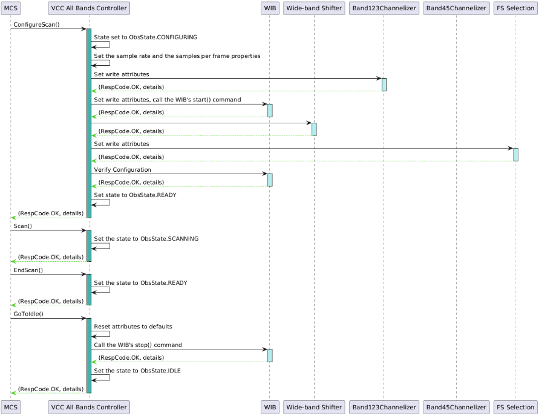

# FHS-VCC All Bands Controller - ICD MCS to FHS-VCC
### Overview
This document serves as the internal ICD between MCS and the FHS-VCC. The FHS-VCC All Bands Controller provides the control layer between MCS and the subordinate FHS-VCC devices. Implemented as a Tango Device server using the 1.0.0+ version of the ska-tango-base classes.

- [FHS-VCC All Bands Controller - ICD MCS to FHS-VCC](#fhs-vcc-all-bands-controller---icd-mcs-to-fhs-vcc)
    - [Overview](#overview)
    - [Scenario Diagram](#scenario-diagram)
    - [Device Attributes](#device-attributes)
    - [Device Properties](#device-properties)
    - [Publish Events](#publish-events)
    - [Commands](#commands)
    - [Proposed Commands (Unimplemented)](#proposed-commands-unimplemented)
    - [Command Parameter Definitions](#command-parameter-definitions)
      - [`Abort()`](#abort)
        - [Parameters](#parameters)
        - [Result Codes](#result-codes)
      - [`ConfigureScan()`](#configurescan)
        - [Parameters](#parameters-1)
        - [Result Codes](#result-codes-1)
      - [`ConfigureVCCBite()`](#configurevccbite)
        - [Parameters](#parameters-2)
        - [Result Codes](#result-codes-2)
      - [`DeconfigureVCCBite()`](#deconfigurevccbite)
        - [Parameters](#parameters-3)
        - [Result Codes](#result-codes-3)
      - [`GoToIdle()`](#gotoidle)
        - [Parameters](#parameters-4)
        - [Result Codes](#result-codes-4)
      - [`UpdateSubarrayMembership()`](#updatesubarraymembership)
        - [Parameters](#parameters-5)
        - [Result Codes](#result-codes-5)
    - [Proposed Command Parameter Definitions (Unimplemented)](#proposed-command-parameter-definitions-unimplemented)
      - [`OffloadTransientBufferCapture()`](#offloadtransientbuffercapture)
        - [Parameters](#parameters-6)
      - [`GetStoredGainValues() - Fast Command`](#getstoredgainvalues---fast-command)
        - [Parameters](#parameters-7)
        - [Result Codes](#result-codes-6)
      - [`UpdateDelayModels()`](#updatedelaymodels)
        - [Parameters](#parameters-8)

### Scenario Diagram 

### Device Attributes
| Name                 | Type            | Read/Write | Description                                                                                                                                                                                                                          |
| -------------------- | --------------- | ---------- | ------------------------------------------------------------------------------------------------------------------------------------------------------------------------------------------------------------------------------------ |
| bitErrorRate         | DevFloat        | R          | The ratio of packets received with errors to the total amount of data received. Provides insight into whether or not the data received is usable.                                                                                    |
| configurationState   | DevEnum         | R          | The device's current state of configuration.                                                                                                                                                                                         |
| expectedDishID       | DevString       | R          | Associated dish identifier.                                                                                                                                                                                                          |
| frequencyBand        | DevEnum         | R          | Frequency band that is currently configured.                                                                                                                                                                                         |
| frequencyBandOffset  | Array[DevLong]  | R          | Frequency band offset, received during scan configuration      Length 2 since band 5 needs two values specified, other bands will only use the first value.                                                                    |
| inputSampleRate      | DevULong64      | R          | Input sample rate read attribute.                                                                                                                                                                                                    |
| requestedRFIHeadroom | Array[DevFloat] | R          | Requested RFI Headroom, in decibels (dB), to be applied when Auto-set gains is requested. May contain a single value to apply to all frequency slices, or `num FS` values to apply to each FS separately (default: 3 dB for all FS). |
| subarrayID           | DevUShort       | R          | Current subarray for which the VCC is a member.                                                                                                                                                                                      |
| vccGains             | Array[DevFloat] | R          | Read attribute for applied gain multipliers size=`Num of selected FSs * pol`.                                                                                                                                                        |

### Device Properties
| Name                                        | Type    | Description                                                                                             |
| ------------------------------------------- | ------- | ------------------------------------------------------------------------------------------------------- |
| ip_blocks                                   | Dict    | Base64-encoded string containing the deploy-time properties of all IP blocks managed by the controller. |
| switch_ip                                   | String  | IP address of the VCC unit's switch.                                                                    |
| unit_number                                 | Integer | VCC unit index within the CBF's 24 VCC units.                                                           |
| fpga_number                                 | Integer | FPGA index within the VCC unit's 2 FPGAs.                                                               |
| long_running_command_result_buffer_max_size | Integer | Depth of the LRC command results buffer.                                                                |

### Publish Events
| Name                | Type    | Description                                                                 |
| ------------------- | ------- | --------------------------------------------------------------------------- |
| subarray_id         | Integer | Publishes a change event whevever the VCC's subarray ID changes.            |
| configuration_state | Integer | Publishes a change event whenever the configurationState attribute changes. |

### Commands
| Name                         | Input Type  | Input Parameter | Description                                                                                                                                                                                                                                                                                                                                                                                                                                                                                                |
| ---------------------------- | ----------- | --------------- | ---------------------------------------------------------------------------------------------------------------------------------------------------------------------------------------------------------------------------------------------------------------------------------------------------------------------------------------------------------------------------------------------------------------------------------------------------------------------------------------------------------- |
| `Abort()`                    | JSON String | See below.      | Sets the device state to ABORTED and aborts all running/queued commands.                                                                                                                                                                                                                                                                                                                                                                                                                                   |
| `ConfigureScan()`            | JSON String | See below.      | Configure parameters for the next scan(s). Parameters are propagated down to low-level device servers. Sets the state to CONFIGURING, if the input JSON can be successfully parsed the state is set to READY.                                                                                                                                                                                                                                                                                              |
| `ConfigureVCCBite()`         | JSON String | See below.      | Command to configure VCC Bite and apply the input configuration provided. The parameters are propogated to low-level servers.                                                                                                                                                                                                                                                                                                                                                                              |
| `DeconfigureVCCBite()`       | JSON String | See below.      | Command to deconfigure VCC Bite. The low-level servers are deconfigured and the previously applied configuration is removed.                                                                                                                                                                                                                                                                                                                                                                               |
| `GoToIdle()`                 | JSON String | See below.      | Resets the device and changes the state to IDLE                                                                                                                                                                                                                                                                                                                                                                                                                                                            |
| `UpdateSubarrayMembership()` | Integer     | Subarray ID     | Command to update the current subarray membership of the VCC. If the VCC is not currently assigned to a subarray, i.e. its subarray_id attribute is 0, then its membership is updated and the subarray_id attribute is set appropriately. Otherwise, if the current subarray_id > 0, indicating the VCC has already been assigned to a different subarray, then the command is REJECTED.      The VCC’s subarray membership can also be cleared using this command, by providing a subarray ID of 0. |

### Proposed Commands (Unimplemented)
| Name                                  | Input Type  | Input Parameter                             | Description                                                                                                                                                                                                                                                                                                                                                                                                                   |
| ------------------------------------- | ----------- | ------------------------------------------- | ----------------------------------------------------------------------------------------------------------------------------------------------------------------------------------------------------------------------------------------------------------------------------------------------------------------------------------------------------------------------------------------------------------------------------- |
| `AutoSetTCBGain()`                    | Scalar      | Dwell Time                                  | This command triggers algorithm that measures and adjusts Transient Capture Buffer (TCB) re-quantizer gain settings to provide optimal sensitivity. ‘Dwell time” specifies how long to integrate to determine the quantizer gain settings (seconds).       Applies gain corrections on fine channels.                                                                                                                   |
| `GetBandpassCorrectionCoefficients()` | (TBD)       | (TBD)                                       | **Placeholder:** TBD: Retrieves Bandpass correction coefficients required when PSS is configured.                                                                                                                                                                                                                                                                                                                             |
| `GetStoredGainValues()`               | int         | Optional - Index for a frequency band {1-6} | Returns a 2-Dimensional list of previously set auto-set gains.       - Valid band index provided - Returns a 2-Dim arr with at index 0 the gains applied for the given band   - Valid band index provided with no prior scan for that band - Returns an empty list   - No index provided - Returns a 2-Dim arr of format [i → frequency band, j → gain value for channel i, pol % 2]                              |
| `OffloadTransientDataCapture()`       | Timestamp   | Starting epoch to begin transient capture   | Command which triggers the offload of transient data for the given VCC. Data is offloaded relative to the start time of the capture and the duration configured within the scan. On command execution, writing to the transient buffer is locked, and it is iterated over to construct a capture, starting at the provided start time and lasting for the provided duration, before it is transmitted over the 400GbE to SDP. |
| `UpdateDelayModels()`                 | JSON string | See below.                                  | Update delay tracking with new High order delay models required for PSS processing.                                                                                                                                                                                                                                                                                                                                           |
| `UpdateJonesMatrix()`                 | (TBD)       | (TBD)                                       | **Placeholder:** Applies updates to Jones Matrix polarization correction for fine channels.                                                                                                                                                                                                                                                                                                                                   |

### Command Parameter Definitions

#### `Abort()`
##### Parameters
| Name                        | Type   | Description                                        | Range |
| --------------------------- | ------ | -------------------------------------------------- | ----- |
| transaction_id *(optional)* | String | Optional identifier that will be used for tracing. |       |
##### Result Codes
| Outcome | Result Code     | Description | Message              |
| ------- | --------------- | ----------- | -------------------- |
| Success | `ResultCode.OK` |             | `Abort completed OK` |

#### `ConfigureScan()`
##### Parameters
| Name                                 | Type                       | Description                                                                                                                                                                                                                       | Range                                                           |
| ------------------------------------ | -------------------------- | --------------------------------------------------------------------------------------------------------------------------------------------------------------------------------------------------------------------------------- | --------------------------------------------------------------- |
| config_id                            | String                     | Identifier of the current scan configuration.                                                                                                                                                                                     |                                                                 |
| dish_sample_rate                     | Integer                    | Dish sample rate factoring in the frequency band and the K value.                                                                                                                                                                 | `3960000000` - `11891998800`                                    |
| expected_dish_id                     | String                     | Expected Dish ID for the VCC.                                                                                                                                                                                                     | `MKT000`-`MKT063` or  `SKA001`-`SKA133`                      |
| frequency_band                       | String                     | Frequency band for the current scan.                                                                                                                                                                                              | `1`,`2`, `3`, `4`, `5a`, or `5b`                                |
| frequency_band_offset_stream1        | Integer                    | See `frequencyBandOffset` attribute description.                                                                                                                                                                                  | `-100000000` - `100000000`                                      |
| frequency_band_offset_stream2        | Integer                    | See `frequencyBandOffset` attribute description.                                                                                                                                                                                  | `-100000000` - `100000000`                                      |
| vcc_gains_stream_1                   | Array[Number]              | Specifies the gain of each channel in the VCC for stream 1. (e.g. VCC-B123 OSPPFB or VCC-B45 OSPPFB 1)  Size = `num_vcc_channels_` * `num_polarizations_`   Bands 1, 2, 3 → Size = 20, Bands 4, 5a, 5b → Size = 30 | (TBD)                                                           |
| noise_diode_transition_holdoff_count | Integer                    | Number of sample frames that indicates the worst case state transition in the event of packet loss/corruption within the Wideband Input Buffer.                                                                                   | `0` - `65535`                                                   |
| band_5_tuning                        | Number                     | Center frequency for the band-of-interest. Required if band is 5a or 5b; not specified for other bands                                                                                                                            | Band 5a: `5.85` - `7.25` GHz  Band 5b:  `9.55` - `14.05` GHz |
| b123_power_meter                     | Object[`PowerMeterConfig`] | Configuration for the wideband power meter pre-B123 OSPPFB Channelizer                                                                                                                                                            |                                                                 |
| b45_1_power_meter                    | Object[`PowerMeterConfig`] | Configuration for the wideband power meter pre-B45 sub-band 1 OSPPFB Channelizer                                                                                                                                                  |                                                                 |
| b45_2_power_meter                    | Object[`PowerMeterConfig`] | Configuration for the wideband power meter pre-B45 sub-band 2 OSPPFB Channelizer                                                                                                                                                  |                                                                 |
| fs_lanes                             | Array[`FSLaneConfig`]      | Configuration for the set of (up to) 26 FS power meters. Array size is relative to the configured frequency band:  Band 1, 2 → Size = 10 Band 4 → Size = 15 Band 5a, 5b → Size = 26.                               |                                                                 |
| transaction_id *(optional)*          | String                     | Optional identifier that will be used for tracing.                                                                                                                                                                                |

**PowerMeterConfig**
| Name      | Type    | Description                                                                                                                                                                                                                                                                                            | Range                                         |
| --------- | ------- | ------------------------------------------------------------------------------------------------------------------------------------------------------------------------------------------------------------------------------------------------------------------------------------------------------ | --------------------------------------------- |
| averaging | Integer | Averaging interval in seconds. The power meters implement a block moving average; when interval `t` ends, the accumulated power is divided by `t` to produce an average power value. The power accumulators are then reset to start a new block average. (Used for Wideband and FS lanes power meters) | >= `1`                                        |
| flagging  | Integer | Specifies the mode used to handle flagged data.                                                                                                                                                                                                                                                        | 0 - Ignore 1 - Use 2 - Saturate and use |

**FSLaneConfig**
| Name        | Type                       | Description                                                                                             | Range                     |
| ----------- | -------------------------- | ------------------------------------------------------------------------------------------------------- | ------------------------- |
| vlan_id     | Integer                    | VLAN identifier for use in network switch map to the given FS to an FSP (Used for the VCC Stream Merge) | [[2, 1001], [1006, 4094]] |
| fs_id       | Integer                    | Identifier of the frequency slice                                                                       | [1, 26]                   |
| power_meter | Object[`PowerMeterConfig`] | Power Meter configuration to configure the ND Power Meter for the fs lane equal to `fs_id`.             |                           |

**PSSConfig (Unimplemented)**
| Name                      | Type                         | Description                                                                                                                                                                                           | Range       |
| ------------------------- | ---------------------------- | ----------------------------------------------------------------------------------------------------------------------------------------------------------------------------------------------------- | ----------- |
| `search_window`           | Array of SearchWindow Config | Provides configuration for up to two 300 MHz Search Windows, providing input Transient Capture Buffer and/or PSS beam-forming.                                                                        | Size=1 or 2 |
| `rdt`                     | RDTConfig                    | See below definition. **TBD:** The size of this config relative to the 6 RDTs.                                                                                                                        |             |
| `enable_tcb`              | bool                         | Is Transient Capture Buffer enabled?                                                                                                                                                                  |             |
| `tcb_fs_ids`              | int[2]                       | FS Identifiers for use in the TB FS Selection block prior to requantization.   Assumption packetizing information can be derived from the `vcc_id` and `search_window_id`.                      |             |
| `tcb_period_before_epoch` | int                          | Period before requested epoch to capture transient data.                                                                                                                                              | 2s or 4s    |
| `tcb_period_after_epoch`  | int                          | Period after requested epoch to capture transient data.                                                                                                                                               | 20s or 40s  |
| `tcb_bit_size`            | int                          | The bit size of the FS to be requantized to for use in the buffers.                                                                                                                                   | 4 or 8      |
| `tcb_destination_addr`    | string                       | Destination address for offload of transient buffer data. This must be validated to map to the SDP port, due this **TBD** if we need to provide this configuration option if we know the destination. |             |

**SearchWindowConfig (Unimplemented)**
| Name                           | Type | Description                                                                                                                                                                                  | Range                                                                                                                                                                                                                        |
| ------------------------------ | ---- | -------------------------------------------------------------------------------------------------------------------------------------------------------------------------------------------- | ---------------------------------------------------------------------------------------------------------------------------------------------------------------------------------------------------------------------------- |
| `search_window_id`             | int  | Identifier of the 300MHz Search Window.  Unique within a sub-array.                                                                                                                    | 1-2                                                                                                                                                                                                                          |
| `search_window_tuning`         | int  | The Search Window tuning in Hertz (Hz) is provided in absolute terms as RF center frequency. Based on this, Mid.CBF calculates its tuning within the data stream received from the receptor. | The Search Window must be placed within the observed Band. If partially out of the observed Band a warning is generated. If completely outside of the observed Band an exception is generated and configuration is rejected. |
| `search_window_size` **(TBD)** | int  | Parameter to specify the sizes of the SWs, provided as integers 1,2, …, 10, which represent multiples of 40 MHz                                                                              |                                                                                                                                                                                                                              |

**RDTConfig (Unimplemented)**
| Name                                 | Type   | Description                                                                                                                                                                                                                                                                                                                                          | Range |
| ------------------------------------ | ------ | ---------------------------------------------------------------------------------------------------------------------------------------------------------------------------------------------------------------------------------------------------------------------------------------------------------------------------------------------------- | ----- |
| `input_sample_rate`                  | long   | The sample rate of the incoming signal.                                                                                                                                                                                                                                                                                                              | >= 0  |
| `output_sample_rate`                 | long   | The desired sample rate of the outgoing signal.                                                                                                                                                                                                                                                                                                      | >= 0  |
| `fo_validity_interval`               | double | The duration, in seconds, for which each FODM should be valid, i.e., this should represent the difference between each FODM's start_ts and stop_ts. Default is 0.01 (10ms).                                                                                                                                                                          | >= 0  |
| `fo_fill_threshold`                  | long   | The "needs filling" threshold of elements in the FW circular buffer, below which the DS will start generating and loading more FODMs into the FW. Default is 3000 (30 seconds of 10ms FODMs).                                                                                                                                                        | >= 0  |
| `fo_low_threshold`                   | long   | The "low" threshold of elements in the FW circular buffer, below which the DS will move to a DEGRADED HealthState. Default is 500 (5 seconds of 10ms FODMs).                                                                                                                                                                                         | >= 0  |
| `first_input_timestamp_start_offset` | double | The time offset, in seconds, which is added to the current timestamp of the IP to determine the minimum allowed start timestamp, rounded up to the next PPS, for FODMs to be provided to the FW driver (which then loads them into the circular buffer). All FODMs generated with start timestamps before this calculated minimum will be discarded. | >= 0  |
| `num_lsq_points`                     | long   | The number of points to use in the Least Squares (LSQ) linear fitting algorithm for converting HODMs to FODMs. Default is 100.                                                                                                                                                                                                                       | >= 0  |
| `freq_down_shift`                    | double | The frequency downshift that was applied to the input signal in the VCC IP(?).                                                                                                                                                                                                                                                                       |       |
| `freq_align_shift`                   | double | A fine frequency shift to additionally apply to the output signal. This covers any residual wideband frequency shift and alignment of channels between frequency slices.                                                                                                                                                                             |       |
| `freq_wb_shift`                      | double | The wideband (WB) frequency shift that was applied to the input signal in the Frequency Shifter IP(?).                                                                                                                                                                                                                                               |       |
| `freq_scfo_shift`                    | double | The frequency shift required due to SCFO sampling. (TODO: Need more detail?)                                                                                                                                                                                                                                                                         |       |

##### Result Codes
All error responses include the optional `transaction_id` field (if it was supplied in the request) so the caller can correlate request and response.
| Outcome                  | Result Code           | Description                                                                                                   | Message                                                           |
| ------------------------ | --------------------- | ------------------------------------------------------------------------------------------------------------- | ----------------------------------------------------------------- |
| Success                  | `ResultCode.OK`       |                                                                                                               | `ConfigureScan completed OK`                                      |
| Bad request              | `ResultCode.REJECTED` | Provided configuration does not match required JSON schema definition or input critieria for a specific band. | `Arg provided does not meet ConfigureScan criteria: {reason}`     |
| State model violation    | `ResultCode.REJECTED` | There was an attempt to call a command that violates the current ObsState.                                    | `Attempted to call ConfigureScan command from an incorrect state` |
| Low-level driver failure | `ResultCode.REJECTED` | Error configuring a IP block low-level device.                                                                | `ResultCode.REJECTED`                                             | `Configuration of low-level fhs device failed: {device name}` |
| Server error             | `ResultCode.FAILED`   | Unexpected error occured on server.                                                                           | `Failed to an unexpected exception during ConfigureScan`          |

#### `ConfigureVCCBite()`
##### Parameters
| Name                        | Type                                                | Description                                                                                                 | Range     |
| --------------------------- | --------------------------------------------------- | ----------------------------------------------------------------------------------------------------------- | --------- |
| receiver                    | Object[`VCCAllBandsConfigureVCCBiteReceiverConfig`] | Configuration of the VCC receiver.                                                                          |           |
| source                      | Object[`VCCAllBandsConfigureVCCBiteSourceConfig`]   | Configuration of the VCC source.                                                                            |           |
| rfi                         | Array[`VCCAllBandsConfigureVCCBiteRfiConfig`]       | Up to two RFI tone definitions (one per polarization).                                                      |           |
| utc_start_time              | Integer                                             | Desired UTC start time of the observation expressed as seconds since the Unix epoch (1970‑01‑01T00:00:00Z). | (TBD)     |
| band                        | Integer                                             | Frequency‑band used by the VCC.                                                                             | `1` - `5` |
| transaction_id *(optional)* | String                                              | Optional identifier that will be used for tracing.                                                          |           |

**VCCAllBandsConfigureVCCBiteReceiverConfig**
| Name                    | Type                                                  | Description                      | Range                        |
| ----------------------- | ----------------------------------------------------- | -------------------------------- | ---------------------------- |
| dish_id                 | String                                                | Dish identifier used by the VCC. | (TBD)                        |
| dish_sample_rate        | Integer                                               | Dish sample‑rate (Hz).           | `3960000000` - `11891998800` |
| noise_diode             | Object[`VCCAllBandsConfigureVCCBiteNoiseDiodeConfig`] | Noise‑diode (ND) configuration.  |                              |
| noise_info *(optional)* | Object[`VCCAllBandsConfigureVCCBiteNoiseInfoConfig`]  | Optional “noise‑info” details.   |                              |

**VCCAllBandsConfigureVCCBiteNoiseDiodeConfig**
| Name                    | Type    | Description                                      | Range |
| ----------------------- | ------- | ------------------------------------------------ | ----- |
| dwell_time_us           | Integer | ND “on/off” dwell time in micro‑seconds.         | (TBD) |
| random_pattern_seed     | Integer | Seed for the random ND on/off pattern generator. | (TBD) |
| on_state_scaling_factor | Number  |                                                  | (TBD) |

**VCCAllBandsConfigureVCCBiteNoiseInfoConfig**
| Name  | Type                                                         | Description                                               | Range |
| ----- | ------------------------------------------------------------ | --------------------------------------------------------- | ----- |
| pol_x | Object[`VCCAllBandsConfigureVCCBiteNoiseInfoPolarityConfig`] | Configuration parameters for the X-Polarization.          |       |
| pol_y | Object[`VCCAllBandsConfigureVCCBiteNoiseInfoPolarityConfig`] | Optional configuration parameters for the Y-Polarization. |       |

**VCCAllBandsConfigureVCCBiteNoiseInfoPolarityConfig**
| Name       | Type    | Description                                           | Range |
| ---------- | ------- | ----------------------------------------------------- | ----- |
| seed       | Integer | Seed for the polarization's Gaussian‑noise generator. | (TBD) |
| noise_std  | Integer | Standard deviation of the polarization's noise.       | (TBD) |
| noise_mean | Integer | Mean (offset) of the polarization's noise.            | (TBD) |

**VCCAllBandsConfigureVCCBiteSourceConfig**
| Name                 | Type                                                 | Description | Range |
| -------------------- | ---------------------------------------------------- | ----------- | ----- |
| noise_info           | Object[`VCCAllBandsConfigureVCCBiteNoiseInfoConfig`] | Noise‑info. |       |
| pol_coupling_rho     | Number                                               |             | (TBD) |
| pol_Y_1_sample_delay | Boolean                                              |             |       |

**VCCAllBandsConfigureVCCBiteRfiConfig**
| Name               | Type                                                       | Description                                                                                                                                         | Range |
| ------------------ | ---------------------------------------------------------- | --------------------------------------------------------------------------------------------------------------------------------------------------- | ----- |
| pol_x              | Object[`VCCAllBandsConfigureVCCBiteRfiInfoPolarityConfig`] | Configuration parameters for the X-Polarization.                                                                                                    |       |
| pol_y *(optional)* | Object[`VCCAllBandsConfigureVCCBiteRfiInfoPolarityConfig`] | Optional configuration parameters for the Y-Polarization. Unused for VCC Bite; FW is unable to produce and independent tone for the Y-polarization. |       |

**VCCAllBandsConfigureVCCBiteRfiInfoPolarityConfig**
| Name      | Type    | Description                                           | Range |
| --------- | ------- | ----------------------------------------------------- | ----- |
| frequency | Integer | Frequency (Hz) of the polarization's RFI tone.        | (TBD) |
| scale     | Number  | Amplitude scaling factor for the polarization's tone. | (TBD) |

##### Result Codes
All error responses include the optional `transaction_id` field (if it was supplied in the request) so the caller can correlate request and response.
| Outcome                  | Result Code           | Description                                                                                                   | Message                                                          |
| ------------------------ | --------------------- | ------------------------------------------------------------------------------------------------------------- | ---------------------------------------------------------------- |
| Success                  | `ResultCode.OK`       |                                                                                                               | `ConfigureVCCBite completed OK`                                  |
| Bad request              | `ResultCode.REJECTED` | Provided configuration does not match required JSON schema definition or input critieria for a specific band. | `Arg provided does not meet ConfigureVCCBite criteria: {reason}` |
| Low-level driver failure | `ResultCode.REJECTED` | Error configuring a IP block low-level device.                                                                | `ResultCode.REJECTED`                                            | `Configuration of low-level driver: {driver name}` |
| Server error             | `ResultCode.FAILED`   | Unexpected error occured on server.                                                                           | `Failed to an unexpected exception during ConfigureVCCBite`      |

#### `DeconfigureVCCBite()`
##### Parameters
| Name                        | Type   | Description                                        | Range |
| --------------------------- | ------ | -------------------------------------------------- | ----- |
| transaction_id *(optional)* | String | Optional identifier that will be used for tracing. |       |
##### Result Codes
| Outcome | Result Code     | Description | Message                           |
| ------- | --------------- | ----------- | --------------------------------- |
| Success | `ResultCode.OK` |             | `DeconfigureVCCBite completed OK` |

#### `GoToIdle()` 
##### Parameters
| Name                        | Type   | Description                                        | Range |
| --------------------------- | ------ | -------------------------------------------------- | ----- |
| transaction_id *(optional)* | String | Optional identifier that will be used for tracing. |       |
##### Result Codes
| Outcome | Result Code     | Description | Message                           |
| ------- | --------------- | ----------- | --------------------------------- |
| Success | `ResultCode.OK` |             | `DeconfigureVCCBite completed OK` |

#### `UpdateSubarrayMembership()`
The command is an LRC to ensure no race conditions can occur between subarrays.
##### Parameters
| Name                        | Type    | Description                                                                           | Range      |
| --------------------------- | ------- | ------------------------------------------------------------------------------------- | ---------- |
| subarray_id                 | Integer | Subarray ID to assign this VCC to. If 0, the subarray membership of the VCC is reset. | `0` - `16` |
| transaction_id *(optional)* | String  | Optional identifier that will be used for tracing.                                    |            |
##### Result Codes
All error responses include the optional `transaction_id` field (if it was supplied in the request) so the caller can correlate request and response.
| Outcome     | Result Code           | Description                                                                                                                                                                                  | Message                                                          |
| ----------- | --------------------- | -------------------------------------------------------------------------------------------------------------------------------------------------------------------------------------------- | ---------------------------------------------------------------- |
| Success     | `ResultCode.OK`       |                                                                                                                                                                                              | `ConfigureVCCBite completed OK`                                  |
| Bad request | `ResultCode.REJECTED` | The VCC is already assigned to a subarray and the ID provided is not equal to 0, or the requested subarray ID is outside of the valid range. Membership must be cleared before reassignment. | `Arg provided does not meet ConfigureVCCBite criteria: {reason}` |

### Proposed Command Parameter Definitions (Unimplemented)

#### `OffloadTransientBufferCapture()`
##### Parameters
| Name               | Type | Description                                        | Range |
| ------------------ | ---- | -------------------------------------------------- | ----- |
| `epoch_start_time` | long | Epoch start time to begin transient buffer capture |       |

#### `GetStoredGainValues() - Fast Command`
##### Parameters
| Name      | Type           | Description                                                                                                                   | Range |
| --------- | -------------- | ----------------------------------------------------------------------------------------------------------------------------- | ----- |
| `band_id` | int - Optional | Frequency Band of interest for retrieving gain corrections (uses same definition as Frequency Band used within ConfigureScan) | 1-6   |
##### Result Codes
Returns a `Float[][][]` of digital bandpass corrections for the specified of `band_id`. 
If a `band_id` is not provided All gains corrections are returned of the format `[i → frequency band, j → gain value for channel i, pol % 2]`

#### `UpdateDelayModels()`
##### Parameters
| Name                  | Type                                   | Description | Range |
| --------------------- | -------------------------------------- | ----------- | ----- |
| `start_validity_sec`  | Double                                 |             |       |
| `cadence_sec`         | Double                                 |             |       |
| `validity_period_sec` | Double                                 |             |       |
| `config_id`           | String                                 |             |       |
| `subarray`            | Integer                                |             |       |
| `receptor_delays`     | Array of JSON (format Receptor Delays) |             |       |

**Receptor Delays Config**
| Name              | Type             | Description                               | Range |
| ----------------- | ---------------- | ----------------------------------------- | ----- |
| `receptor`        | uint16           | Receptor id to update the delay model for | TBD   |
| `xypol_coeffs_ns` | Vector of Double |                                           |       |
| `ypol_offset_ns`  | Double           |                                           |       |